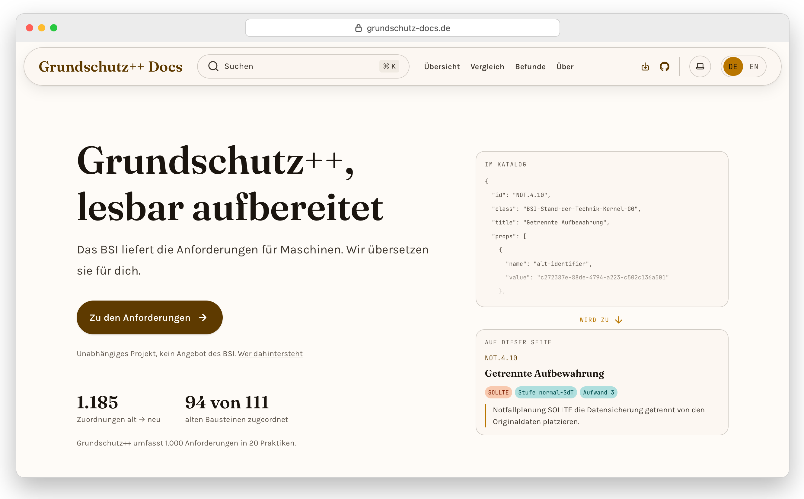
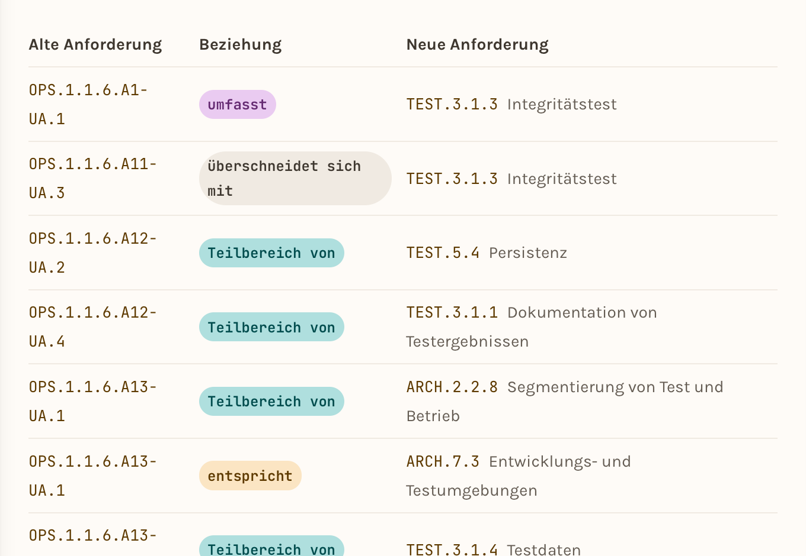

# Grundschutz++ Docs

The BSI ships its Grundschutz++ security catalog as a 92,000-line OSCAL JSON
file — built for SSP-generation tooling, unreadable by a human who just
wants to know what a control requires. This project turns that same JSON
into a site you'd actually want to read: full-text search, one permalink
per control, security level / effort / base threats / target object
categories shown inline, a side-by-side mapping to the old
IT-Grundschutz-Kompendium control it replaces, entry pages per role, a
summary of the BSI methodology, an Excel/CSV export, a changelog of the
catalog, dark mode, and a print-to-PDF per topic area.

This is an unofficial, independent project — not affiliated with,
endorsed by, or produced by the Bundesamt für Sicherheit in der
Informationstechnik (BSI).

<p align="center">
  <a href="https://grundschutz-docs.de">
    <picture>
      <source media="(prefers-color-scheme: dark)" srcset=".github/images/home-dark.png">
      
    </picture>
  </a>
  <br>
  <sub>The start page: the BSI's raw OSCAL entry above, the readable page it becomes below. German UI, English landing page at <a href="https://grundschutz-docs.de/en/">/en/</a>.</sub>
</p>

<p align="center">
  <a href="https://grundschutz-docs.de/vergleich/">
    <picture>
      <source media="(prefers-color-scheme: dark)" srcset=".github/images/comparison-dark.png">
      
    </picture>
  </a>
  <br>
  <sub>The comparison: each old requirement next to its Grundschutz++ counterpart, with the relationship type from the BSI's mapping file (which the BSI marks as a draft; the site says so).</sub>
</p>

## What's on the site

The UI is German; the catalog text is the BSI's German original and is not
translated.

- **Catalog** (`/grundschutzpp/`) — every requirement, one page per practice,
  with obligation level, security level, effort, base threats and target
  object categories inline, and the BSI's topic tags (`/grundschutzpp/themen/`)
- **Roles** (`/rollen/geschaeftsfuehrung/`, `/rollen/isb/`, `/rollen/devs/`) —
  entry pages for management, ISB and developers
- **Comparison** (`/vergleich/`) — old Kompendium requirement ↔ new
  requirement, from the BSI's mapping file
- **Methodology** (`/methodik/`) — the BSI Standard 300-1 in five steps, as
  an own summary
- **Status & timeline** (`/grundschutzpp/zeitplan/`) — the BSI's milestones
- **Target object categories** (`/zielobjekte/`) — one page per category of the
  BSI hierarchy (39): the requirements that apply directly, and those inherited
  from the categories above (STM.2.1.4.1), with the BSI's synonyms and examples
  to find a category by the word you use for your system
- **Documents** (`/dokumente/`) — the 62 document types the catalog names in
  `documentation`, grouped by the BSI category, with the BSI description
  verbatim (with source) and the requirements that name each type; the
  requirement pages carry a "Dokumentiert in" pill, and each target-object
  page lists the documents its requirements name. The pages say that this is
  not evidence: `result` is the subject of the requirement
- **Export** (`/export/`) — the requirements as an Excel file or CSV, as a checklist
  (Markdown or formatted, for tickets and wikis), and every selection has an address
  (`?ziel=Webserver,Cloud-Dienste`), where a value that no longer exists is reported
  instead of silently widening the selection,
  filterable by practice, obligation level, security level, effort and target
  object category (the categories above a chosen one are included, as the
  catalog requires in STM.2.1.4.1), with columns for tracking the implementation status and an
  overview of the documents the catalog names. The Excel file is built in the
  browser; nothing is sent to a server
- **Changelog** (`/aenderungen/`) — what changed in the catalog between two
  published versions, as a diff (old and new wording, changed words
  highlighted). Built from the git history of the BSI repository; it
  describes, it doesn't rate. Subscribe via RSS: `/aenderungen/feed.xml`
  (one item per published version that changed something; IDs and counts
  only, no BSI wording)
- **Findings** (`/befunde/`) — a public register of inconsistencies found in
  the catalog, and of this site's own mistakes
- **Data for language models** (`/rag/`) — the catalog as JSONL, see
  [Related](#related)

## Why this exists

There's already a community-built viewer for the catalog with more visual
firepower than this site aims for — graphs, diagrams. This one is going
for something different: a clean, modern reading experience — searchable,
permalinked, comfortable to sit down with. The BSI's catalog content stays
CC BY-SA, exactly as licensed; the code here is MIT.

Past that, the pilot catalog is JSON-first by design — built for tooling
and SSP generation, not for reading. Keeping it current here means running
the generator against the upstream source automatically, not
hand-transcribing it once and letting it rot.

Reading the catalog this closely also surfaces places where it doesn't add
up — overlapping requirements, mappings that don't quite hold, missing
cross-references. Those findings get published too, in a public register
(`/befunde/`) — fact, interpretation, or observation, each labeled as
such, with a status from open to fixed. The site's own bugs go in the same
register, in the same format: a register that only points outward is an
instrument, not a register.

Two tools go with the reading. The export puts the requirements into a table
with columns for status, responsible person and deadline. The changelog
shows what changed between two published versions of the catalog: the
commit messages for those versions mostly read "publish rolling artifacts"
and don't say what changed, so the changelog compares the versions
themselves.

## Hosted instance

A hosted instance is live at [grundschutz-docs.de](https://grundschutz-docs.de)
— free to use, no setup required. It runs **this** code: there is no
separate tier, no feature held back, nothing you can't run yourself. The
convenience is the hosting, not a different version of the site.

An earlier plan split the project into this repo plus a closed-source
"hosted" layer with richer components. That split was dissolved after a
day — the components live here now, under MIT like everything else. The
reasoning, including what it cost and why it was wrong, is in
[`adr/0008`](adr/0008-aufloesung-des-oss-hosted-splits.md).

## Status

The upstream catalog is being phased in alongside the existing
IT-Grundschutz-Kompendium, on a multi-year timeline (pilot, public
presentation, optional certification, eventual full replacement). The
site tracks whatever the catalog looks like at build time — see the
in-site "Status & Zeitplan" page for the current phase and dates, and the
changelog for what has changed in the catalog itself.

## Getting started

```sh
pnpm install
pnpm run dev      # http://localhost:4321
pnpm run build    # production build to ./dist/
pnpm run preview  # preview the production build locally
```

Requires the pnpm version pinned in `package.json` (`packageManager`).
Site name and operator data (imprint, privacy policy) come from `.env`, see
`.env.example`. Analytics (Plausible) is only included if
`PLAUSIBLE_SCRIPT_URL` is set.

### Self-hosting

```sh
docker compose up -d   # http://localhost:8080
```

The `Dockerfile` builds the site with Node and serves the result with nginx
(`docker/nginx.conf`). `.env` is read at build time, so changing it means
rebuilding the image. The generated pages are committed, so the build needs
neither Python nor access to the BSI catalog.

The image is based on `nginx-unprivileged`: nginx runs as user 101 instead of
root and listens on **port 8080** (an unprivileged user may not bind ports
below 1024). If you put a reverse proxy in front, point it at port 8080; with
the old image this was port 80, so a port mapping like `"8080:80"` or a Traefik
label `loadbalancer.server.port=80` has to become `8080`. nginx adds security
headers to every response (`docker/security-headers.conf`) but does not set
HSTS, since the proxy that terminates TLS should do that.

## How the docs are generated

The pages under `src/content/docs/grundschutzpp/` are generated, not
hand-written. `scripts/generate_docs.py` reads the BSI's
`Grundschutz++-resolved_catalog.json` (OSCAL) and renders Starlight MDX
from it — MDX rather than plain markdown so the generated pages can use
real components (`ControlMeta` for the obligation/level/effort pills,
`PdcaCycle`, the filter inputs) instead of bold-text metadata. It needs
`python3` and nothing from PyPI (standard library only), plus `git` for the
changelog.

Locally, it expects a `Grundschutz-PlusPlus` checkout of
[`BSI-Bund/Stand-der-Technik-Bibliothek`](https://github.com/BSI-Bund/Stand-der-Technik-Bibliothek)
as a sibling directory. Make it a full clone, not a shallow one: the
changelog compares the published versions, so it needs the history.

```sh
cd Grundschutz-PlusPlus && git pull
python3 ../Grundschutz-Docs/scripts/generate_docs.py
cd ../Grundschutz-Docs && pnpm run build
```

What a run writes:

- the pages under `src/content/docs/` `grundschutzpp/`, `rollen/`,
  `vergleich/`, `zielobjekte/` and `dokumente/`. Edit those in `scripts/generate_docs.py`, never in the
  `.mdx` — the next run overwrites them. `DESCRIPTION_OVERRIDES` there keeps
  a few shortened meta descriptions for search results
- `src/data/*.json` — the figures for the homepage and timeline, the
  baustein lookup, and `changelog.json`
- `public/downloads/` — the CSV files (all requirements and one per practice),
  the JSON the export page filters from, and `LIZENZ.txt`

**The changelog is incremental.** `changelog.json` has one entry per BSI
commit that changed the catalog. A run only computes commits that are not in
the file yet. Without git history (shallow clone, no git repository) it says
so and leaves the file alone. The oldest version covered is 27 July 2026;
before that the catalog lived at a different path in the BSI repository.

**The generator refuses to write something wrong.** After a run it checks the
numbers on the pages (`check_invariants()`), the export files
(`check_export()`), the target object pages (`check_zielobjekte()`), the document
pages (`check_dokumente()`) and the changelog (`check_changelog()`) against the source,
each recomputed by a second path that does not reuse the code that produced the
value (for the changelog it reads the same git history, but flattens the whole
tree instead of picking fields). The rule and the incident behind it are in `CONTRIBUTING.md`
("Numbers on the site"). One more check is not about numbers: `check_sync_paths()` fails the
run if the generator writes into a folder that the daily sync PR would not pick up.

Instead of the sibling checkout, the generator can read its inputs from files you name
(the sync workflow does this): `GRUNDSCHUTZPP_CATALOG`, `GRUNDSCHUTZPP_BASETHREATS`,
`GRUNDSCHUTZPP_MAPPING`, `GRUNDSCHUTZPP_TAGS`, `GRUNDSCHUTZPP_TARGETS` and
`GRUNDSCHUTZPP_DOCUMENTATION`. The variables are listed in `.github/workflows/sync-catalog.yml`.

Each run also writes `src/data/upstream.json`: the newest BSI commit that changed one of those six
input files (not the head of the BSI repository, which moves for unrelated reasons). The workflow
`.github/workflows/generated.yml` checks out exactly that commit on every push and pull request, runs
the generator and fails if anything differs from what is committed, including files that are missing
from the commit. That catches a hand edit of a generated page, a generator change nobody re-ran and an
overwritten `upstream.json` before the next daily sync would silently undo them. If it fails, run the
generator against the commit it names and commit the result.

In CI, `.github/workflows/sync-catalog.yml` runs on a daily schedule,
checks the upstream catalog out directly (with its full history, without file
contents, they are loaded on demand), regenerates everything above, and opens a
pull request if anything changed — review the diff before merging (see
CONTRIBUTING.md). `.github/workflows/ci.yml` runs a production build on
every push and pull request.

### The Excel export

The export page builds the Excel file in the browser with a small writer of
its own (`src/lib/xlsx/`, on top of `fflate`) instead of a general-purpose
library: the export needs a handful of features (several sheets, frozen rows,
autofilter, dropdowns, hyperlinks), and a general-purpose library would have
brought about 175 transitive packages. The writer is only loaded when
the button is clicked.

Excel is strict about the order of XML elements and answers a mistake with
"repair this file" and no hint what is wrong. `scripts/xlsx/verify.py`
checks a file four independent ways (the ECMA-376 schema, package
consistency, a read-back with `exceljs`, and LibreOffice), and
`scripts/xlsx/compare.py` compares every cell with the CSV the generator
wrote. Both need things that are not in this repository (the schema,
`exceljs`); the header of `verify.py` says where to get them. They run by
hand, not in CI.

## Project structure

```
.
├── adr/                       # architecture decisions, with the reasoning
├── docker/nginx.conf          # web server config for the image
├── Dockerfile                 # build with Node, serve with nginx
├── docker-compose.yml         # generic self-hosting template
├── public/downloads/          # generated — CSV, JSON and license text of the export
├── scripts/
│   ├── generate_docs.py       # OSCAL catalog → MDX, data files, export, changelog
│   └── xlsx/                  # checks for the Excel files (run by hand)
├── src/
│   ├── components/            # ControlMeta, PdcaCycle, ExportTabelle, Aenderungsprotokoll, Befund*, filters, header/hero overrides
│   ├── data/                  # generated — landing, status, bausteine, changelog (JSON)
│   ├── lib/xlsx/              # the Excel writer used by the export page
│   ├── content/docs/
│   │   ├── grundschutzpp/     # generated — the catalog, one page per practice
│   │   ├── rollen/            # generated — entry pages per role
│   │   ├── vergleich/         # generated — one page per old↔new mapping
│   │   ├── zielobjekte/       # generated — one page per target object category (see adr/0011)
│   │   ├── dokumente/         # generated — one page per document type (see adr/0012)
│   │   ├── befunde/           # the findings register (see adr/0009)
│   │   ├── en/                # hand-written English pages (not a catalog translation)
│   │   ├── index.mdx          # homepage
│   │   ├── methodik.mdx       # summary of BSI Standard 300-1
│   │   ├── export.mdx         # the export page
│   │   ├── aenderungen.mdx    # the changelog page
│   │   ├── rag.mdx            # the catalog as data for language models
│   │   ├── ueber.mdx          # about
│   │   ├── impressum.mdx      # legal notice template (see adr/0003)
│   │   └── datenschutz.mdx    # privacy policy template
│   └── styles/custom.css      # OKLCH palette, light + dark
├── .github/workflows/         # ci.yml (build), sync-catalog.yml (daily catalog PR)
├── astro.config.mjs           # site title, sidebar, i18n, Starlight plugins
└── .env                       # SITE_NAME, operator data (see .env.example)
```

## Contributing

Non-code input counts too — a different reading of a requirement, a gap,
an open question; see `CONTRIBUTING.md` for the low-friction way in. The
same file covers what's expected in a PR (build must pass, generator
changes need an actual run and diff review, check both color schemes and
both mobile/desktop layouts); `CODE_OF_CONDUCT.md` has the community
expectations.

## Related

[`grundschutz-docs/rag`](https://github.com/grundschutz-docs/rag) is the
data pipeline behind this site for people who want to build their own
search or chatbot on the catalog: the same controls as JSONL plus a small
Qdrant indexing script.

## What's next

Not promises, just what's on the list — open an issue if you want to pick
one of these up (see `CONTRIBUTING.md`):

- Better theme browsing: the BSI tags are on every control as pills, in
  search as a "Thema" filter, and collected on `/grundschutzpp/themen/`.
  They cover only 470 of the 1,000 controls, so a richer view (per-theme
  pages, filters on the catalog pages) would mostly expose that gap
- The requirement package for a target object category as a file (CSV, JSON,
  Markdown) under a stable address, and as a shareable link with the selection
  (the export page already reads `?ziel=` and `?praktik=`), so tickets, wikis and
  other tools can fetch "the package for web servers" directly
- An OSCAL explainer page — what it is, and why a German agency adopted a
  NIST-originated format instead of building its own
- A sheet in the Excel export that maps the old Kompendium requirements to
  the new ones, once the BSI's mapping file is no longer marked as a draft
- The Excel checks (`scripts/xlsx/`) in CI. They need the ECMA schema and
  `exceljs`, which is why they are not there yet
- The English side is hand-written pages for foreign companies operating
  in Germany (home, about, legal pages, "operating in Germany"). The
  catalog itself, the comparison, the export, the changelog and the findings
  register are German-only; a real English translation of the catalog is
  not started

## License

- **Code**: MIT — see `LICENSE`.
- **Catalog content** (the Grundschutz++ text rendered under
  `src/content/docs/grundschutzpp/`): CC BY-SA 4.0, © BSI-Bund, per the
  upstream catalog's own license. This site's generated pages inherit that
  license from their source.
- **Files and pages derived from the catalog** (the export under
  `public/downloads/`, the Excel file the export page builds, and the
  changelog): they contain catalog text, so they are CC BY-SA 4.0 too. The
  attribution, the license and the note that they are modified are in the
  files themselves (`LIZENZ.txt`, the info sheet of the Excel file, the
  source column) and not only on the web page.
- **The page on the BSI Standard 300-1** (`/methodik/`): an own summary. The
  source is © BSI and is not under CC BY-SA; the BSI's
  [terms of use](https://www.bsi.bund.de/DE/Service/Nutzungsbedingungen/Nutzungsbedingungen_node.html)
  apply to it. The old IT-Grundschutz-Kompendium is not reproduced: the
  comparison pages and the export only name its requirement IDs and link to
  the BSI's PDFs.
- **Original text** (the findings register under `src/content/docs/befunde/`,
  and the ADRs under `adr/`): CC BY 4.0 — a content license fits prose
  better than a software license does, see [`adr/0010`](adr/0010-lizenz-fuer-eigene-texte.md).

The BSI-OSCAL catalog itself follows [OSCAL](https://pages.nist.gov/OSCAL/),
a standard originating from NIST that the BSI adopted rather than building
a proprietary format.
